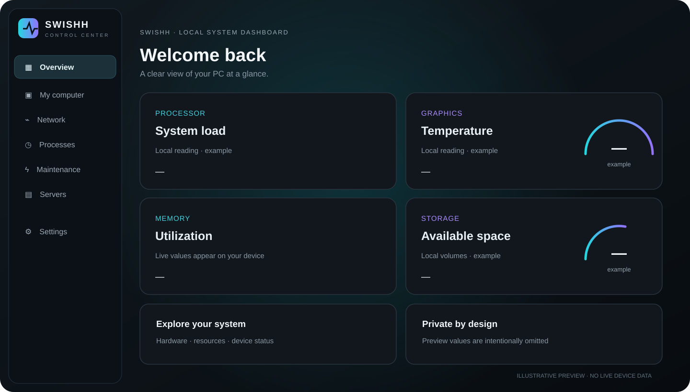
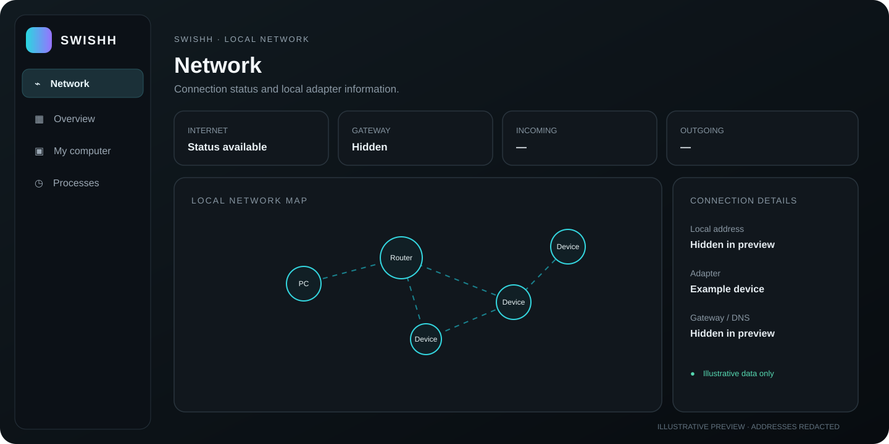

# SWISHH CONTROL CENTER

**A local-first Windows system dashboard** built with Tauri, React, TypeScript, and Rust.

SWISHH CONTROL CENTER brings common PC health and system information into one desktop interface. It is an independent project and is not affiliated with or endorsed by Microsoft or hardware vendors.

> Public build note: screenshots below are illustrative previews. They contain no live device information. The app reads selected system information from the computer where it runs; this repository does not contain the developer's monitoring history, private settings, or machine-specific data.

## Features

- Overview of processor, memory, graphics, storage, and network information.
- Local network and adapter status view.
- Storage volumes and physical drive inventory.
- Service and Docker status overview where supported.
- Dark interface with scalable layout for 1920×1080 and 2K displays.
- Windows desktop app packaged with Tauri.

Some readings depend on Windows APIs and available hardware. VPN, optimization, or repair actions are not represented as available unless explicitly implemented in the current build.

## Screenshots

These are anonymized, illustrative interface previews; values are placeholders, not readings from a real PC.





## Requirements

- Windows 10 or Windows 11, x64.
- For source builds: Node.js 22 or newer, npm, Rust stable, and the Windows C++ Build Tools / WebView2 prerequisites required by Tauri 2.

## Install

Download **SWISHH CONTROL Setup** from the latest [GitHub Release](https://github.com/SODKFJDIOASGJSGJ40EIJG34U/swishh-control/releases/latest), run the installer, and launch SWISHH CONTROL CENTER from the Start menu.

## Build from source

```powershell
git clone https://github.com/SODKFJDIOASGJSGJ40EIJG34U/swishh-control.git
cd swishh-control
npm ci
npm run tauri -- build --bundles nsis
```

The NSIS installer is produced under `src-tauri/target/release/bundle/nsis/`.

## Use

Launch the app and choose a section in the left navigation. System and network panels show information collected locally from the current Windows installation. Review any value before sharing a screenshot or support log. The app does not need an account to display local system information.

## Privacy and security

- No personal device snapshot, local log, monitoring history, token, password, or private configuration is distributed in this repository.
- `.env` files, logs, build outputs, and local machine state are excluded by `.gitignore`.
- The network page checks reachability by sending ICMP probes to the local gateway and `1.1.1.1`. The application source contains no account telemetry or data-upload endpoint.
- The app is intended for local use. Review source code and permissions before building or distributing modified versions.
- Public availability does not grant permission to redistribute or relicense the code. No license is included yet.

## Automation

GitHub Actions builds the x64 NSIS package on pushes and pull requests. Pushing a version tag such as `v0.1.2` creates a GitHub Release and attaches the installer.

---

# SWISHH CONTROL CENTER (Русский)

**Локальная панель состояния Windows-компьютера** на Tauri, React, TypeScript и Rust.

SWISHH CONTROL CENTER собирает основные сведения о системе в одном настольном приложении. Это независимый проект, не связанный с Microsoft и производителями оборудования.

> Для публичной версии: скриншоты ниже — демонстрационные макеты. В них нет актуальных данных компьютера. Приложение локально получает отдельные сведения о системе, на которой запущено; в репозитории нет личной истории мониторинга, приватных настроек или снимка компьютера разработчика.

## Возможности

- Сводка по процессору, памяти, графике, накопителям и сети.
- Просмотр локальной сети и состояния адаптера.
- Список томов и физических накопителей.
- Обзор служб и Docker, если они доступны.
- Тёмный интерфейс с адаптацией под разрешения 1920×1080 и 2K.
- Настольная сборка для Windows на Tauri.

Некоторые показатели зависят от API Windows и установленного оборудования. Возможности VPN, оптимизации и восстановления доступны только в том случае, если они реализованы в текущей версии.

## Скриншоты

Это обезличенные демонстрационные макеты интерфейса; значения условные и не получены с реального компьютера.


## Требования

- Windows 10 или Windows 11, x64.
- Для сборки из исходников: Node.js 22 или новее, npm, стабильный Rust и необходимые для Tauri 2 компоненты Windows C++ Build Tools / WebView2.

## Установка

Скачайте **SWISHH CONTROL Setup** из последнего [GitHub Release](https://github.com/SODKFJDIOASGJSGJ40EIJG34U/swishh-control/releases/latest), запустите установщик и откройте SWISHH CONTROL CENTER через меню «Пуск».

## Сборка из исходников

```powershell
git clone https://github.com/SODKFJDIOASGJSGJ40EIJG34U/swishh-control.git
cd swishh-control
npm ci
npm run tauri -- build --bundles nsis
```

Установщик NSIS появится в `src-tauri/target/release/bundle/nsis/`.

## Использование

Запустите приложение и выберите раздел в левой панели. Разделы системы и сети показывают сведения, локально полученные из текущей установки Windows. Перед публикацией скриншота или журнала поддержки проверьте его содержимое. Для отображения локальных показателей учетная запись не требуется.

## Конфиденциальность и безопасность

- В репозиторий не включены личный снимок системы, локальные журналы, история мониторинга, токены, пароли или приватные настройки.
- `.env`, журналы, результаты сборки и локальное состояние исключены через `.gitignore`.
- Страница сети проверяет доступность шлюза и `1.1.1.1` с помощью ICMP-запросов. В исходном коде приложения нет телеметрии учётной записи или адреса загрузки пользовательских данных.
- Приложение рассчитано на локальное использование. Перед сборкой или распространением изменённых версий проверьте исходный код и разрешения.
- Публичный репозиторий сам по себе не даёт права распространять код или менять условия его использования. Лицензия пока не добавлена.

## Автоматическая сборка

GitHub Actions собирает x64-установщик NSIS при отправке изменений и для pull request. Тег версии, например `v0.1.2`, запускает создание GitHub Release с установщиком.

